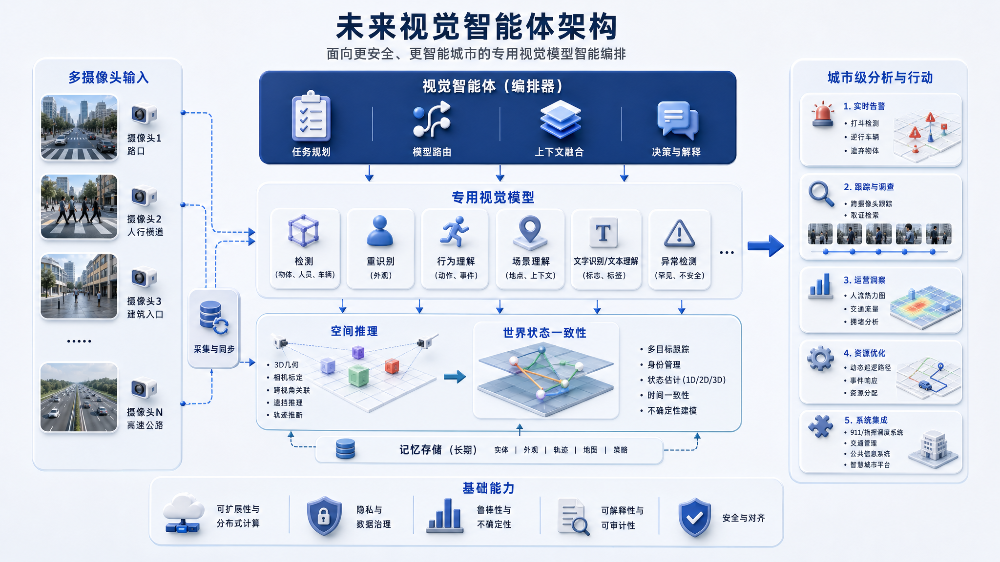

# dsh-video-retrieval

DeepSeek Harness 原生视频检索插件：把监控视频时空目标定位能力打包成标准 DSH 模式，一键安装即可在 DSH 网页里使用。

- **输入**：一段监控视频 + 一句自然语言描述（或一张人脸/人体参考图）
- **输出**：目标出现的**时间区间 + 逐帧 bbox 轨迹 + 标注视频**
- **硬件目标**：Apple Silicon（MPS）/ CUDA / CPU，本地推理为主、云端只做稀疏语义增强

---

## 系统远景与本插件定位

下面这张图是监控视频分析系统的**顶层愿景**——「未来视觉智能体架构」，面向更安全、更智能的城市：



图中描绘的是一个**城市级**闭环：多摄像头输入 → 采集与同步 → 视觉智能体（编排器）做任务规划/模型路由/上下文融合 → 专用视觉模型（检测、重识别、行为理解、场景理解、文字识别、异常检测）→ 空间推理 + 世界状态一致性（跟踪、身份、轨迹）→ 长期记忆存储 → 城市级分析与行动，底层由「基础能力」（可扩展、隐私治理、可解释、安全对齐）支撑。

**本插件正是这套系统的原型（prototype）**——它落地了图中核心的一条「垂直切片」，并留出了向上扩展的接口：

| 远景架构层 | 本插件（原型）的对应实现 | 状态 |
|---|---|---|
| 多摄像头输入 / 采集与同步 | 单路视频 + `preflight`（解码预检、IMKH/MPEG-PS 恢复、抽帧同步） | ✅ 单路；多路是演进方向 |
| 视觉智能体（编排器） | DSH 会话智能体 + 任务路由（`router`）+ 16 个 `vr_*` 工具 | ✅ |
| 专用视觉模型 | YOLO-World（检测）、OSNet/ArcFace/CLIP（重识别）、OCR（文字识别） | ✅ |
| 空间推理 / 世界状态一致性 | BoT-SORT 跟踪 + 逐帧 bbox 轨迹 + 时间区间 + 多信号投票 | ✅ 单场景一致性 |
| 长期记忆存储 | 案例库 + 演化配置（thresholds/confusables/prompts）+ 技能手册 | ✅ |
| 基础能力 | 自进化闭环、证据护栏（"insufficient 是判定而非漏检"）、视频不出本地 | ✅ |
| 城市级分析与行动 | 实时告警、跨摄像头协同、运营洞察 | ⏳ 未覆盖，架构已预留 |

换句话说：**图是"要建的城市级系统"，插件是"已经能跑的最小闭环"**——从"一段视频里按描述找人/车/牌"这个最硬的核心场景起步，验证了「视觉智能体编排 + 专用模型 + 多信号一致 + 自进化」这条主线。

---

## 目录

- [功能](#功能)
- [安装](#安装)
- [模型权重说明](#模型权重说明)
- [原理与架构](#原理与架构)
- [检索流程](#检索流程)
- [测试数据](#测试数据)
- [测试与门禁](#测试与门禁)
- [路径与状态根](#路径与状态根)
- [目录结构](#目录结构)
- [更新](#更新)
- [开发者：引擎与后端的关系](#开发者引擎与后端的关系)
- [排障与已知限制](#排障与已知限制)
- [卸载](#卸载)
- [许可](#许可)

---

## 功能

- **自然语言 / 参考图检索**：文本描述或人脸/人体图 → 时间区间 + 逐帧框 + 标注视频
- **云边协同漏斗**：云端粗筛时间段 + 本地精查 + 多信号交叉验证
- **多信号甄别**：衣着色相 / 时间相似度曲线 / VLM 图对图终审 / **WeVisOne 本地 referring**，最多四票（默认 ≥2，`--agree 3` 进精确模式）
- **云端可选**：`WEVISONE_DOWNLOAD=1` 后纯文本分支与终审本地化，无 key 全流程可跑（实测已验证）
- **递归自进化**：案例确认 → Optuna 阈值优化 + 提示词/混淆表反射 → holdout 门禁 → 热加载
- **嵌入式三列控制台**：保留左侧会话列表，随时切回 DeepSeek 对话
- **流水线实时可视化**：控制台底部 Dify 风格 DAG（视频输入→预检→路由→粗筛/检测/去重→多信号→投票→输出），标明每步模型，SSE 驱动节点状态与数据流动画
- **16 个原生工具**：`vr_search` / `vr_preflight` / `vr_job_cancel` / `vr_evolve` 等

---

## 安装

### 方式一（推荐）：作为插件直接安装

```bash
# 1. 安装插件包（dsh.bundle 自动合入 profile；prepare 会构建 dist/index.js）
dsh plugin --profile web add github:zhouql-dev/dsh-video-retrieval

# 2. 部署预设 + 下载权重（install.sh 从 profile 里定位已安装的包）
git clone https://github.com/zhouql-dev/dsh-video-retrieval.git /tmp/dsh-video-retrieval
bash /tmp/dsh-video-retrieval/scripts/install.sh

# 3. 重启 DSH（bundle 补丁是启动时事实）
npx @deepseek-ai/dsh web
```

> **安装时发生了什么**：`package.json` 的 `main`/`exports` 指向 `packages/vr-plugin/dist/`，
> 而 `dist/` 不入库 —— 它由 `prepare` 在安装时生成（`node packages/vr-plugin/build.mjs`）。
> 如果你的环境设了 `ignore-scripts=true`（CI / 离线镜像常见），`prepare` 不会跑，
> 装出来会缺 `dist/index.js`：这类环境请改用 Release 里的 `dsh-video-retrieval-dist.tar.gz`
> （解到包根即可），或先 `bash scripts/install.sh` 再装。

### 方式二：从源码安装（开发）

```bash
git clone https://github.com/zhouql-dev/dsh-video-retrieval.git
cd dsh-video-retrieval
bash scripts/install.sh          # 构建 + 安装包 + 部署预设 + 下载权重
npx @deepseek-ai/dsh web
```

然后在新建会话界面选择 **视频检索模式**。

### 前置条件

- Node ≥ 22、pnpm
- Python ≥ 3.10 + venv（含 torch / ultralytics / opencv-python / rapidocr-onnxruntime / insightface / transformers / torchreid / scipy / optuna / fastapi / uvicorn / litellm）
- ffmpeg、tesseract（车牌 OCR）
- 可选 API key：`DEEPSEEK_API_KEY`（推荐，视觉 VLM 默认）/ `ZHIPUAI_API_KEY` / `DASHSCOPE_API_KEY`（无 key 时自动降级到本地全扫，不崩不谎报）

### VLM 提供商（`VLM_PROVIDER=deepseek|glm|qwen`）

云端视觉判断走 OpenAI 兼容接口，可任意切换，缺失时自动逐级 fallback（deepseek → glm → qwen），全无则静默降级到本地全扫：

| 提供商 | 视觉模型 | 文本模型 | 说明 |
|---|---|---|---|
| **deepseek**（默认） | `deepseek-v4-flash-vision-exp` | `deepseek-v4-flash` | 前沿视觉推理，价格最省；**不支持原生视频**，云 grounding 仍回落 Qwen |
| `glm` | `glm-4v-flash`（可 `GLM_VISION_MODEL` 覆盖） | `glm-5.1` | 免费档、弱；付费档常 `429 余额不足` |
| `qwen` | `qwen-vl-max` | `qwen-plus` | DashScope 原生 `video_url`，**唯一能做云 grounding 的通道** |

- 视觉 key 复用：未设 `DEEPSEEK_API_KEY` 时，若 `LLM_BASE_URL` 指向 `api.deepseek.com`，自动复用 agent 的 `LLM_API_KEY`。
- Agent 编排 LLM（`LLM_MODEL`）保持独立（默认 `deepseek-v4-pro`），与检索视觉 VLM 分工不同；`/chat` 配置面板可改。
- 权限可配：`ground` 工具仍要求 `DASHSCOPE_API_KEY`（原生视频），其余视觉调用可用 deepseek 完成。

---

## 模型权重说明

插件需要以下模型权重。前三个由 `scripts/setup.sh` 从 GitHub Releases 下载到**包内 `models/`**（桌面 profile 是软链安装，即仓库的 `models/`）；insightface 模型由库自动下载到 `~/.insightface/`。

| 权重 | 引擎 | 用途 | 大小 | 必需 | 下载位置 |
|---|---|---|---|---|---|
| `yolov8s-worldv2.pt` | YOLO-World（开放词表检测） | **文本 → 目标框**：`set_classes([描述词])` 即可检测任意名词，本地 grounding 主力 | ~26 MB | ✅ | `models/yolov8s-worldv2.pt` |
| `osnet_x0_25_msmt17_*.pth` | OSNet（行人重识别） | **参考图 → 认人**：512 维特征余弦相似度，person_search 主引擎 | ~9 MB | ✅ | `models/osnet/` |
| `osnet_x1_0_msmt17_*.pth` | OSNet（行人重识别，高精度） | 同上的**高精度版**（x1.0），默认不用；设 `OSNET_WEIGHTS` 环境变量指向它即可启用 | ~17 MB | ➕ 可选 | `models/osnet/` |
| `ViT-B-32.pt` | CLIP（图文模型） | ① YOLO-World 的**文本编码器**（`set_classes` 依赖）② 兜底图文匹配 | ~350 MB | ✅ | `models/clip/` |
| `buffalo_l`（SCRFD `det_10g.onnx` + ArcFace `w600k_r50.onnx`） | insightface | **人脸识别**：SCRFD 检人脸 + ArcFace 512 维嵌入 | ~300 MB | ⚠️ 人脸检索时 | `~/.insightface/models/buffalo_l/`（首次使用自动下载） |
| `WeVisOne-VL-2B` | 腾讯 WeVisOne-VL（统一感知 VLM） | **本地语义第四票**：referring 定位 + 可靠拒绝（目标不存在返 None），替代/兜底云端 VLM 终审 | ~5.6 GB | ➕ 可选（`WEVISONE_DOWNLOAD=1 bash scripts/setup.sh`） | HuggingFace `tencent/WeVisOne-VL-2B`（自动尝试 hf-mirror） |

> **WeVisOne-VL 说明**：MPS（Apple Silicon）加载 ~9s、单 crop ~1.2s / 批量 ~0.7s；只在**去重后的候选裁剪图**上稀疏推理（几十张），不参与逐帧扫描。缺失时信号自动弃权，检索行为与引入前完全一致。运行时 venv 需可 import `wevisone_vl`（`pip install -e <wevisone检出> --no-deps` + `accelerate qwen_vl_utils safetensors`）。

> **离线部署提示**：完全离线机器需预先把 `buffalo_l` 模型包放进 `~/.insightface/models/buffalo_l/`，否则人脸检索首次调用会尝试联网下载。

**降级链**（某引擎权重缺失时自动逐级退）：`insightface(ArcFace) → CLIP → VLM → 只出裁剪图给人工`，检索永不因缺模型而崩。

**终审降级链**（verify/target 判定）：`WeVisOne 本地 referring（无 key、不出本地）→ 云 VLM（deepseek/glm/qwen，需 key）→ unclear`。语义粗筛仍是云优先（快），`--no-ground` 时全片本地扫描兜底；WeVisOne 的显式拒绝（None）是**有效反对票**，与弃权不同——`--agree 3` 时可拦截色相+曲线双过线的误报。

---

## 原理与架构

### 1. 云边漏斗（Cloud-Edge Funnel）

设计源自两条实测教训：**云端 VLM 会"自信地幻觉"**（图对图全答 yes、粉红混淆打 0.95 分）、**本地 embedding 会"草木皆兵"**（OSNet 阈值 0.55 下 16 个候选里 15 个误报）。结论：**谁都别单独信**——云负责粗筛（快、懂语义），本地负责精查（清、能读字），最后多信号交叉验证。

```
输入 ──► router(任务路由)
          ├── 精确文本(车牌/证件号) ──► 本地 OCR + 字符混淆表 ──► 全片扫描
          └── 语义(人物/物体描述) ───► 云粗筛时间段 ──► 本地检测+裁剪 ──► 三信号投票
```

**铁律**：本地基线永不硬依赖云端。所有云端调用 env-gated 静默降级，失败返 `None/[]`，本地照常运行——**"云端失败 ≠ 目标不存在"**。

### 2. 多信号甄别（§11.2 方法的产品化）

每个候选交给三个独立"证人"打分，**≥2 个（默认）作证才判命中**：

| 信号 | 算法 | 判据 |
|---|---|---|
| 颜色 | HSV 主色相直方图 + 圆形色相差 | 同一人 Δ色相 ≲35°；误报 60–110° |
| 时间曲线 | 相似度序列的"持续抬升占比" | 真人 0.35→0.83→0.35 平滑爬升；单帧尖峰是噪声 |
| VLM 终审 | 图对图"是否同一人" | exact / partial / no |

不能判断的信号**弃权**（灰色没法比颜色、无 key 无法终审），弃权不计入分母；**单一信号永不判命中**；剩余信号不足时给 `insufficient`，不假装结论。

### 3. 递归自进化（Evolution Loop）

```
案例确认 ──► 合并数据集(确认案例 + PRW + CCPD-GT) ──► Optuna 阈值优化
           ──► Layer1 混淆表/提示词反射 ──► holdout 门禁(新≥旧−0.005)
           ──► rollback 快照 ──► 热加载到 <状态根>/config/ ──► 下次检索生效
```

- **评估器极便宜**：信号 raw 值缓存后，优化只是"换阈值→重新投票→数对错"，微秒级。
- **质量分 = macro-F1**：数据极端不平衡（1 真 vs 54 噪声），accuracy 无效。
- `.veto` 冻结演化；`<状态根>/config/rollback/` 存快照；`<状态根>/config/evolutions.jsonl` 审计（状态根默认 `~/.dsh/video-retrieval`）。

### 4. 作为 DSH 插件的结构

```
DeepSeek Harness 进程
├── 宿主半  packages/vr-plugin/src/index.js → 16 个 vr_* 原生工具（defineTool，模式内可见）
├── 客户端半 packages/vr-plugin/dist-client/ → 三列控制台（shell.overlay）+ 侧边栏按钮
├── 预设     packages/vr-plugin/preset/     → 视频检索模式（standard + persona + 自带 skill + 工具）
└── cordis.patch.yml（packages/vr-plugin/）  → 全局 vr-console 行（便携路径，dsh.bundle 自动合入）
          │ HTTP :8788（submit/poll/result; SSE）
          ▼
   后端  packages/vr-backend/vr_backend/server.py（FastAPI，唯一源码）
          │ spawn (SKILL_SCRIPTS=…/engines)
          ▼
   引擎  packages/vr-backend/vr_backend/engines/*.py（preflight / locate / verify_target / person_search / fast_plate_scan）
```

DSH **本身就是 agent 循环**：会话智能体读 skill 手册 → 计划 → 调 vr_* 工具 → 后端跑确定性剧本 → 三信号投票出结果。插件的 `packages/vr-backend/vr_backend/agent/loop.py` 不重复实现它。

---

## 检索流程

### 端到端流水线

```
① preflight  解码预检（识别 IMKH/MPEG-PS 私有封装、冻结帧），必要时 ffmpeg 恢复
② router     车牌/证件号正则 → precise_text；否则 → semantic
③ 分支
   ├─ precise_text：本地 OCR + 字符混淆表（Q↔9/1、G↔6、8↔B…），全片双遍扫描
   └─ semantic：云粗筛时间段(可关) → 窗口内本地检测 + 裁剪 → 三信号投票
④ 输出       intervals.json(时间区间) + matches/boxes.json(逐帧框) + 标注帧 + report.html
```

### 使用流程（DSH 内）

1. 新建会话 → 选 **视频检索模式** → 三列控制台自动打开（也可点侧边栏「视频检索」）
2. 在控制台：选视频（本地解码不出机）→ 输入描述或上传参考图 → 检索
3. 右侧看命中片段（标注帧 + 播放），或直接对话让 agent 用 `vr_*` 工具检索
4. 结果可「确认/否认」，确认即喂给演化层

---

## 测试数据

### 真机系统实测（Apple M4 / 16GB / MPS）

| 查询 | 覆盖率 | 处理 FPS | 峰值内存 | 时间区间数 |
|---|---|---|---|---|
| `person riding a bicycle` | 93% | 25.0 | 1.52 GB | 5 |
| `white car` | 100% | 26.8 | 1.78 GB | 1 |
| `pedestrian … light beige coat`（+VLM） | 94% | 20.1 | 1.79 GB | 2 |

25–27 FPS 高于片源 22 FPS = 真正实时；内存 ~1.5–1.8 GB（≈16GB 的 10%）。

### 开放数据集基准（带 GT，SOTA 对照）

| 数据集 / 任务 | 指标 | 结果 | 口径说明 |
|---|---|---|---|
| Ref-DAVIS17（视频目标定位） | box_tube_iou / temporal_iou | **0.550 / 0.841**（稀疏 pivot Δ=5）@ 88 FPS | 逐帧 dense YOLO-World 为 0.535/0.684；GroundingDINO-Tiny 0.762/0.992 但仅 0.72 FPS（非实时） |
| PRW（参考图→行人检索） | mAP / CMC-1 | **0.427 / 0.998**（OSNet x1.0，余弦协议） | oracle detections 隔离匹配质量；x0.25 为 0.378/0.998 |
| CCPD（车牌检测） | 检测率 / IoU50 | **0.863 / 0.648** | balance 子集文件名已匿名化，识别准确率不可测（仅检测） |
| CCPD-GT（车牌识别，98,459 张） | 读取率 | tesseract 0.30 → **PP-OCRv4 0.98** | 6 位字母数字（无省字符）口径 |
| RSTPReid（文本→行人检索） | R@1（零样本 CLIP） | **0.074** | 训练版 SOTA 0.62，诚实差距 |
| IJB-A（人脸 1:1 验证） | TAR@FAR=0.001 | **0.9555** | 官方 10-split；2019 SOTA 0.92 |

### 端到端验收线（完整云边）

| 验收 | 结果 |
|---|---|
| 人物检索（参考图 80×280 女性，粉外套白裤） | GT 覆盖 **2/2**，误报区间 **18**（基线 91，场景自适应后） |
| 车牌检索「京Q1G728」 | 云 grounding 返空 → 自动全片本地 OCR → 锁定 **838–840s**（5 命中） |
| 自进化（Optuna 阈值） | macro-F1 **0.4549 → 0.4818**；holdout 门禁采纳 |
| 自进化（混淆表反射） | 车牌混淆表 **0.8241 → 1.0**（57 行真实数据） |

### 插件端到端冒烟（DSH 会话实测）

- `vr_preflight` 实测 mp4 → `verdict: OK`（修复了 lossless-JSON 输出边界 bug）
- `vr_search` "car" → `verdict: hit`，区间 `[2.88s, 5.88s]`，逐帧车牌 OCR 收敛到 **粤Q·1G728**

---

## 测试与门禁

一条命令跑全部（不需要 pytest，纯脚本 + 退出码）：

```bash
# 用带 torch/ultralytics 的那个 venv 解释器，不要用系统 python3
PYTHONDONTWRITEBYTECODE=1 python3 tests/run_all.py
# → 合计：401 通过 / 0 失败 / 22 个套件
# → PASS 全部通过
```

三层分工（详见 [`tests/README.md`](tests/README.md)）：

| 层 | 例子 | 回答什么 |
|---|---|---|
| 契约层 | `test_artifacts_contract.py`、`test_paths_contract.py` | 引擎↔服务↔前端的产物格式对不对；Python 与 JS 的路径解析是否一致 |
| 后端单测 | `test_smoke.py`、`test_agent.py`、`test_server.py`、`bench/` | 检索管线、评测指标、服务端点、agent 循环 |
| 回归层 | `test_p0_*.py`、`test_p1_*.py`、`test_p2_*.py`、`golden/` | 某个具体 bug 修完不许回来 |

三道门禁（提交前都该绿）：

```bash
bash scripts/check-consistency.sh   # ① profile↔仓库 ② 一份代码 ③ 路径单点 ④ 工作区
bash scripts/sync.sh --check        # I1：同名模块只出现一次、包内没有可写目录
node packages/vr-plugin/build.mjs && node scripts/smoke.mjs   # 构建 + 16 工具注册 + 客户端 slot
```

CI（`.github/workflows/ci.yml`）四个 job：`build-smoke`（Node 22）、`py-import`、`py-unit`、`no-hardcoded-home`；
`release.yml` 在打 tag 前重跑全量测试。`smoke.mjs` 在拿不到 `@deepseek-ai/dsh-tools` peer 时显式
`exit 3`（跳过），不会假装通过。

---

## 路径与状态根

"东西在哪"只有一个实现：`packages/vr-backend/vr_backend/paths.py`（Python 权威），
`packages/vr-plugin/src/paths.js` 逐条镜像；`tests/test_paths_contract.py` 在
默认 / `VTL_STATE_DIR` / `DSH_HOME` 三种环境下比对两端的输出，漂一个键就红。

```bash
PYTHONPATH=packages/vr-backend $PY -m vr_backend.paths --print
node packages/vr-plugin/src/paths.js --print     # 必须与上面逐键相同
```

| 键 | 解析顺序 |
|---|---|
| `state_root` | `VTL_STATE_DIR` → `$DSH_HOME/video-retrieval` → `~/.dsh/video-retrieval` |
| `weights_root` | `VTL_WEIGHTS_DIR` → `<repo>/models` → `~/.cache/vr/weights` |
| `bench_root` | `BENCH_DATA` → `<repo>/dataset` → `<repo>/../dataset` |
| `engines_dir` | `SKILL_SCRIPTS` → `<backend>/engines` |
| `client_root` | `FUSION_WEB` → `<repo>/packages/vr-plugin/client` |

状态根里放**全部可写数据**：`cases.jsonl`、`jobs/`、`uploads/`、`config/`、`server.log`、
`server.pid`、`server.identity.json`。仓库内没有任何可写目录——升级/重装不动数据。

后端 8788（`VTL_PORT` 可覆盖）、单实例（`flock` 锁 `<state>/server.pid`，第二个实例 exit 2）、
`GET /health` 返回 `{version,pid,nonce,state_root,cases_path}`，插件只认 pid+nonce 一致的进程。

---

## 目录结构

```
dsh-video-retrieval/            # npm 包根（安装入口不变）
├── package.json              # main/exports/dsh 指向 packages/vr-plugin/
├── packages/
│   ├── vr-backend/           # Python 后端 —— 唯一源码
│   │   ├── vr_backend/       #   server.py run.py toolbox.py paths.py config.py …
│   │   │   ├── agent/        #     agent 循环 + 演化
│   │   │   ├── bench/        #     评测脚本
│   │   │   └── engines/      #     引擎脚本（子进程边界）
│   │   ├── requirements.txt
│   │   └── requirements-core.txt
│   └── vr-plugin/            # DSH 插件 —— 唯一 JS 适配层
│       ├── src/index.js      #   宿主半（16 个 vr_* 工具）
│       ├── src/paths.js      #   路径解析（与 paths.py 逐条对齐）
│       ├── client/index.html #   控制台前端（后端静态托管）
│       ├── dist-client/      #   客户端 bundle（__ModuleLoader__ 格式）
│       ├── preset/video-retrieval/   # 模式组合 + 自带 skill
│       ├── cordis.patch.yml  #   bundle 补丁
│       └── build.mjs         #   构建 dist/index.js + dist/paths.js
├── tests/                    # 全部测试（run_all.py 一条命令跑 22 套件）
│   ├── README.md             #   三层划分与约定
│   ├── fixtures/frames3/     #   产物契约用的 3 帧 fixture（100 KB，入库）
│   └── golden/               #   指标 golden 值（手算，改算法即红）
├── scripts/                  # serve/install/setup/sync/check-consistency/smoke/cdp/merge_cases
├── docs/                     # ENTRY-CONTRACT.md（双入口契约）等
├── models/                   # .gitignore；权重（setup.sh 下载到这里）
├── archive/                  # 旧树归档：fusion 代码 tar、旧案例库、旧配置
├── package-lock.json         # npm lock（1 个包）
├── pnpm-lock.yaml            # pnpm lock（9 行；peer 不自动安装）
├── pnpm-workspace.yaml       # autoInstallPeers: false（peers 由 DSH 宿主提供）
└── .github/workflows/        # ci.yml + release.yml

运行时状态**不在仓库里**：默认 `~/.dsh/video-retrieval/`（cases.jsonl / jobs / uploads / config /
server.pid），`VTL_STATE_DIR` 可覆盖。包内没有任何可写目录。
```

---

## 更新

```bash
# 普通用户：重新安装最新版即可
dsh plugin --profile web add github:zhouql-dev/dsh-video-retrieval
bash scripts/install.sh        # 若预设/脚本有更新
# 浏览器刷新页面即可（客户端 bundle 内容变更无需重启 dsh）
```

状态根在包外，升级不动数据；但**改了 `env` / 端口 / 后端代码**要看后端起没起：

```bash
curl -s localhost:8788/health          # {status, version, pid, nonce, state_root, ...}
curl -s -X POST -H 'X-Requested-With: vr-console' localhost:8788/shutdown   # 正常关后端
```

## 开发者：引擎与后端的关系

引擎脚本在 `packages/vr-backend/vr_backend/engines/`，后端在 `packages/vr-backend/vr_backend/` —— **两者都是本仓库的唯一源码**（`fusion/` 已于 2026-11-16 归档，见 `fusion/README-ARCHIVE.md`）。若引擎仍有外部 skill 源，用 `sync.sh` 从那里单向同步（不 `--delete`）：

```bash
VTL_SKILL_DIR=/path/to/skills/video-target-localize   # 有外部 skill 源时才需要
bash scripts/sync.sh                                  # 同步引擎（不 --delete）
bash scripts/sync.sh --check                           # 只校验 I1（一份代码）
```

不设 `VTL_SKILL_DIR` 时跳过同步，只做校验。`scripts/sync.sh` **不会再往这里写后端代码**——
`fusion/` 已归档，再从它 rsync 会把这个包的后端删空。

---

## 排障与已知限制

| 现象 | 原因 | 处理 |
|---|---|---|
| `ERR_PNPM_UNEXPECTED_STORE`（`dsh plugin add` 时） | 该 profile 的 `node_modules` 是旧大版本 pnpm 装的（store v10），DSH 自带 pnpm 11 要 store v11 | 要么 `cd ~/.dsh/profiles/<p> && pnpm install` 重新链到新 store（要联网），要么直接把 `node_modules/dsh-video-retrieval` 软链到本仓库（与 desktop profile 同款） |
| 后端起不来，日志 `[fatal] 已有后端在跑（pid=…）` | 单实例锁（`<state>/server.pid`） | 先 `curl -X POST -H 'X-Requested-With: vr-console' localhost:8788/shutdown`；不行再 `kill <pid>` |
| 插件报 `backend … is a foreign server` | 插件与后端的 `state_root` 不一致（多份状态根） | 两边都跑 `paths.py/paths.js --print` 比对 `state_root`；用 `VTL_STATE_DIR` 对齐 |
| 端口 8788 被别的进程占着 | 上一版后端没退干净 | `lsof -ti tcp:8788` 找 pid；或 `VTL_PORT` 换端口并同步 `backendUrl` |
| 演化一直是 `no_data` | **数据缺口**：案例库 81 条、5 条已确认，但没有一条带 `scored` 的尝试 | 跑一次带 rescoring 的检索并人工确认几例；接线本身是通的（`tests/test_p2_evolve_feed.py` 证明） |
| 装了插件但 16 个工具没出来 | 安装时 `prepare` 没跑（`ignore-scripts=true`），`dist/index.js` 缺失 | 见[安装](#安装)的说明：用 Release asset 或先 `bash scripts/install.sh` |

**已知限制**

- 单路视频；多摄像头协同不在本插件范围（架构里预留了）。
- RSTPReid 零样本 R@1 只有 0.074（训练版 SOTA 0.62）——文本→行人检索是能力短板，如实标注。
- CCPD `balance` 子集的文件名已匿名化，**车牌文本 GT 不可得**，只能测检测、测不了识别。
- WeVisOne 只在去重后的裁剪图上稀疏推理；缺失时该票自动弃权，行为与引入前一致。

---

## 卸载

```bash
rm -rf ~/.dsh/.agent-presets/video-retrieval
dsh plugin --profile web remove dsh-video-retrieval
# 重启 dsh web
```

状态根 `~/.dsh/video-retrieval/`（案例库、任务、上传、配置）**不会**被卸载删除——
里面有唯一不可再生的人工标注，要清就自己确认后 `rm -rf`。权重在 `<repo>/models/` 同理。

## 许可

MIT
